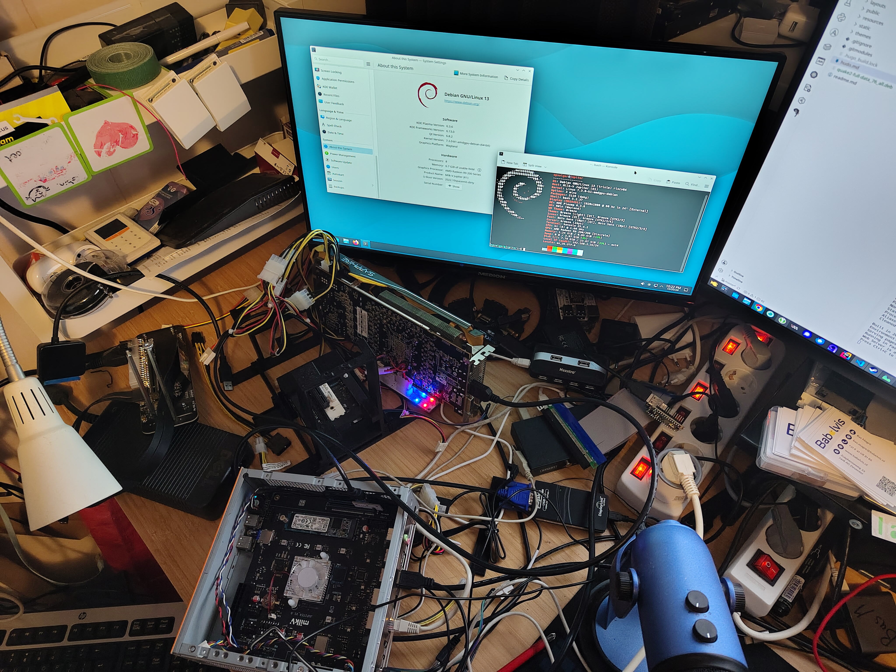
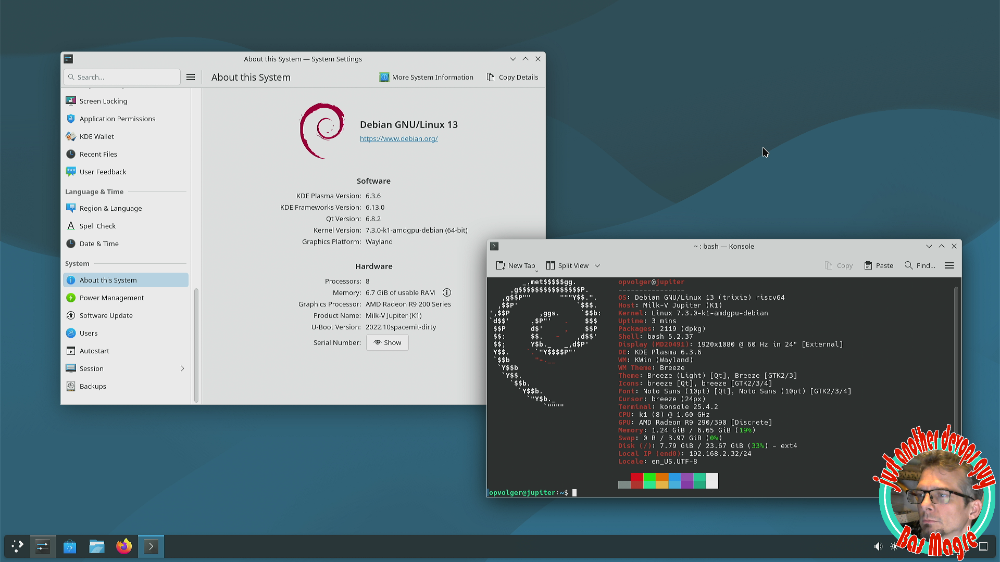

## Intro

More than 2 years ago with a lot of searching/patching/searching/patching etc., I finally had a working kernel with my `AMD Radeon R9 290`. I had some artifacts, but after multiple nights patching I was able to play the game `Factorio` on my board (with box64).

But I didn't save my changes/patches and wiped the directory. I still had some in my [git repo](https://github.com/Opvolger/spacemit-k1-linux-6.6) and tried to get it working again... but gave up.

Now it is 2 years later, and the mainline Linux has support for a lot of the board and the PCI-e controller, so I did give it a try. Too bad, AMDGPU was not working. So I asked `claude` what is missing and how it can be fixed. I don’t expect a real answer. But he gave me one. Here it started!

## Setup

I have a smart-plug and Home Assistant, so with a token Claude can power the device on and off.

I have a USB to serial, so it can send commands to U-Boot.



I started a tftp server with docker, so it can download the kernel that is made after compiling.

I copied the root partition of my StarFive VisionFive 2 to an eMMC.

I compiled U-Boot with my [ansible script](https://github.com/Opvolger/ansible-riscv-sd-card-creater/blob/master/milkv-jupiter-compile-latest.yaml). I commented out some stuff, so only U-Boot was created on my SD card. You can also use the latest vendor U-Boot.

I used the kernel Claude built for me and booted. See all the steps in [my markdown](https://github.com/Opvolger/linux-kernel-jupiter-1/blob/master/milk-v-testing.md).

```bash
setenv serverip 192.168.2.34
setenv fdt_addr_r 0x31000000          # fdt_addr_r does not exist in the env
tftpboot ${fdt_addr_r} ${serverip}:arch/riscv/boot/dts/spacemit/k1-milkv-jupiter.dtb
tftpboot ${kernel_addr_r} ${serverip}:arch/riscv/boot/Image.gz   # ~20 MiB/s
setenv bootargs 'root=/dev/mmcblk0p1 rw swiotlb=131072 console=tty0 console=ttyS0,115200 earlycon rootwait stmmaceth=chain_mode:1 selinux=0'
booti ${kernel_addr_r} - ${fdt_addr_r}
```

And it failed! So I wrote down how `claude` can control all of this, and watched some TV.

When I was back, there was a working AMDGPU! I had a console! Logged in and installed KDE Plasma! Rebooted and logged in. Artifacts!!!

I have an HDMI capture card and let Claude use it to capture the artifacts. So now I had to watch some YouTube on my computer and log in to see if the artifacts were gone.

It worked, I now had no artifacts. So now I gave him the task to use the same config as a Debian kernel. It built, and that one can boot too. It was only unstable :(

After a night of trial and error, Claude found the problem: `performance-governor` was the solution, the `schedutil cpufreq governor` was not stable. So now full power!



## Kernel with PCI-e support

So I now have a kernel with AMDGPU support (for my GPU, maybe more). In the future I will test my other (AMD) GPUs.

What isn't working is my NVMe disk :(

Claude also can create a pipeline in 5 minutes, so here are the kernels: [release v1.0.0](https://github.com/Opvolger/linux-kernel-jupiter-1/releases/tag/v1.0.0)

## GitHub Repo

To not lose all the patches this time, I created a repo (with Claude's help) [linux-kernel-jupiter-1](https://github.com/Opvolger/linux-kernel-jupiter-1).

Here you can see all the commands and trial-and-error runs.

## So now what?

I will test some games with Box64 and FEX?

Try Steam with the new 64-bit application?

I will see!

Maybe let `claude` create a pipeline that gives a trixie setup for Milk-V Jupiter with an AMDGPU? So everybody can do this easily?
